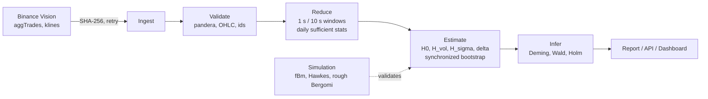

# orderflow-scaling

**Does one number — the persistence `H0` of the signed order flow — fix the roughness of
volume, the roughness of volatility and the market-impact exponent, crypto by crypto?**

A 2026 theory (Muhle-Karbe, Ouazzani Chahdi, Rosenbaum & Szymanski,
[arXiv:2601.23172](https://arxiv.org/abs/2601.23172)) predicts
`H_vol = H0 − 1/2`, `H_σ = 2H0 − 3/2` and `δ = 2 − 2H0`. It was tested only on average,
on 40 stocks. This project tests it **asset by asset on 60 Binance crypto pairs** (spot and
USD-M perpetuals), with estimators validated by simulation and a pre-registered protocol.

> **Result:** *pending — the confirmatory tests run on the frozen confirmation sample
> (2025-11-01 → 2026-10-31) after the tags `prereg-v1` and `config-frozen`.*

<!-- Key figure, rebuilt by `make report`: paper/figures/fig2_h1_hvol.pdf -->

## Reproduce

```bash
uv sync --frozen            # Python 3.12, locked dependencies
make test                   # lint, mypy --strict, tests (coverage >= 85 %)
make sim                    # simulation study: bias / coverage of every estimator
make decide                 # pre-registered estimator choice and CI calibration from the study
make universe               # 60 pairs from Binance Vision -> config/universe.yaml
make data                   # download, verify (SHA-256), validate, reduce (raw files deleted)
make quality                # O1: every pair-day reduced, blocked or explained
git tag prereg-v1           # after committing config/preregistration.md
make estimate-dev           # development sample
git tag config-frozen       # freeze config/ before the confirmation sample
make estimate test-hyp      # confirmation sample: H1-H5, controls, specification curve
make report                 # every figure and table of the paper, then paper/main.pdf
docker compose up -d        # daily pipeline + API + dashboard behind Caddy
```

`make all` rebuilds every table and figure from a clean clone. Without `make` (Windows),
run the same `uv run ofs ...` commands listed in the [Makefile](Makefile).

## How it works



* Raw trades are reduced day by day to windows and **additive daily sufficient statistics**,
  then deleted: every estimate and every bootstrap replicate is a weighted sum of daily rows.
* Every stage is idempotent and versioned per (pair, day, code version); every table has a
  pandera contract checked on write.
* The protocol is enforced in code: no estimator runs on real data before `prereg-v1`, no
  confirmatory run before `config-frozen` with an unchanged configuration.

| Exponent | Principal estimator | Control |
|---|---|---|
| `H0` | mixed fBm on aggregated variance (weighted NLS) | sign autocorrelation in event time |
| `H_vol` | moments of the volume rate | moments of log-rate (autocovariance-GMM reported) |
| `H_σ` | GJR moments on daily RV | Whittle (Fukasawa–Takabatake–Westphal) |
| `δ` | runs of same-sign trades, `E[I | Q] ~ Q^δ` | same, on run duration |

Final principal/control choices for `H_vol` and `H_σ` follow the simulation rule of
[config/preregistration.md](config/preregistration.md) §4.1.

## Status (2026-11-09)

| Phase | State |
|---|---|
| P0 Framing | done: repository, CI, tooling, pre-registration draft, literature check ([docs](docs/literature-watch.md), monthly arXiv watch) |
| P1 Ingestion and reduction | done and hardened on real data: statistics = naive computation to 3.5e-15; a BTCUSDT perpetual day of 4.3 M trades (2025-10-10 crash) reduced in 13.9 s with 1.4 GB peak memory (target < 60 s, < 8 GB) |
| P2 Simulation and estimators | full study (365 days, 200 replications, 82 cells) running; estimator choice and CI calibration then follow mechanically from the pre-registered rule (`make decide`), before the tag `prereg-v1` |
| P3 Full universe, development | universe: 60 pairs, 59 perpetuals (PAXG and WBTC left out by decision); real 24-month backfill (2024-11-01 → 2026-10-31) running, then the 5-year daily-volatility history and the O1 report (`make quality`) |
| P4 Confirmation and tests | after the tags `prereg-v1` and `config-frozen` |
| P5 Production | Docker, compose, Caddy, cron, Healthchecks, R2 backups; the daily run replays late files and applies re-published ones; deployment on a VM pending |
| P6 Report | LaTeX paper and 10-slide deck built from the generated figures; results pending |

What the real data changed is recorded as decisions and incident notes:
[ADR 0009](docs/adr/0009-ohlc-check-in-ticks.md) (OHLC check),
[ADR 0010](docs/adr/0010-catch-up-and-corrections.md) (catch-up, corrections),
[ADR 0011](docs/adr/0011-five-year-volatility-history.md) (5-year history),
[ADR 0012](docs/adr/0012-trade-id-continuity.md) (trade-id continuity),
[incidents](docs/incidents/README.md).

## Repository

```
config/       universe, estimation grids, pre-registration (versioned, frozen by tags)
src/ofs/      ingest, validate, reduce, simulate, estimators, inference, report, api, cli
dashboards/   Streamlit (tests, asset sheet, pipeline health, simulation)
tests/        unit, property (Hypothesis), simulation (known-H recovery)
paper/        LaTeX working paper and slides, figures and tables generated by `make report`
scripts/      real-day benchmark, monthly arXiv watch, backups
docs/         MkDocs site, architecture decision records, incident notes
```

Data: [Binance Vision](https://data.binance.vision) (free, no API key), licensed under
CC BY-NC-SA 4.0 by the Binance Vision Dataset Terms. Raw Binance files are never
redistributed; the derived statistics, results and figures are published under the same
CC BY-NC-SA 4.0 licence with attribution to Binance Vision ([DATA_LICENSE.md](DATA_LICENSE.md)).
Code under the MIT licence. Non-commercial academic research: not affiliated with or
endorsed by Binance, and not investment advice.
