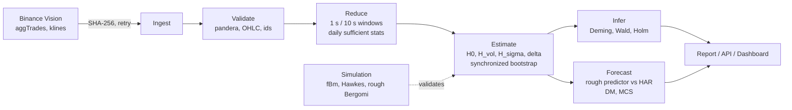

# orderflow-scaling

**Does one number — the persistence `H0` of the signed order flow — fix the roughness of
volume, the roughness of volatility and the market-impact exponent, crypto by crypto?**

A 2026 theory (Muhle-Karbe, Ouazzani Chahdi, Rosenbaum & Szymanski,
[arXiv:2601.23172](https://arxiv.org/abs/2601.23172)) predicts
`H_vol = H0 − 1/2`, `H_σ = 2H0 − 3/2` and `δ = 2 − 2H0`. It was tested only on average,
on 40 stocks. This project tests it **asset by asset on 60 Binance crypto pairs** (spot and
USD-M perpetuals), with estimators validated by simulation and a pre-registered protocol.
A forecasting extension then asks whether that roughness **forecasts** daily volatility and
volume out of sample, and whether the roughness implied by order flow forecasts as well as
the one measured on volatility ([docs/forecasting.md](docs/forecasting.md)).

> **Result:** *pending — the confirmatory tests run on the frozen confirmation sample
> (2025-11-01 → 2026-10-31) after the tags `prereg-v1` and `config-frozen`.*

**At a glance**

* **Data**: 24 months of every Binance trade for 60 pairs, spot and USD-M perpetuals
  (Binance Vision), each file SHA-256-verified and validated against the klines, reduced to
  additive daily statistics; a 4.3 M-trade crash day reduces in 14 s. Five years of
  1-minute klines for daily volatility and volume.
* **Statistics**: four exponents per pair; estimators chosen by a pre-registered simulation
  study (82 cells × 200 replications, noise included); block bootstrap synchronized across
  pairs and calibrated for long memory; Deming regression, joint Wald tests, Holm.
* **Protocol in code**: no estimate on real data before the git tag `prereg-v1`, no
  confirmatory run before `config-frozen` with an unchanged configuration.
* **Forecasting**: an exact rough-volatility predictor against HAR, Diebold–Mariano and
  model confidence set, out of sample; live daily forecasts with a scored track record.
* **Production**: daily Docker pipeline (late and re-published files handled), read-only
  API, dashboard, Healthchecks, change-point alarms on `H0`, a WebSocket L2 collector.
* **Quality**: `mypy --strict`, ruff, 217 tests (92 % coverage), MkDocs site,
  14 architecture decision records, incident notes.

<!-- Key figure, rebuilt by `make report`: paper/figures/fig2_h1_hvol.pdf -->

## Reproduce

```bash
uv sync --frozen            # Python 3.12, locked dependencies
make test                   # lint, mypy --strict, tests (coverage >= 85 %)
make sim                    # simulation study: bias / coverage of every estimator
make decide                 # pre-registered estimator choice and CI calibration from the study
make universe               # 60 pairs from Binance Vision -> config/universe.yaml
make data                   # download, verify (SHA-256), validate, reduce (raw files deleted)
make quality                # O1: every pair-day reduced, blocked or explained
git tag prereg-v1           # after committing config/preregistration.md
make estimate-dev           # development sample
git tag config-frozen       # freeze config/ before the confirmation sample
make estimate test-hyp      # confirmation sample: H1-H5, controls, specification curve
make forecast               # forecasts of daily volatility and volume, tests F1-F3
make sim-forecast           # forecast models on simulated rough volatility
make report                 # every figure and table of the paper, then paper/main.pdf
docker compose up -d        # daily pipeline + API + dashboard behind Caddy
```

`make all` rebuilds every table and figure from a clean clone. Without `make` (Windows),
run the same `uv run ofs ...` commands listed in the [Makefile](Makefile).

## How it works



* Raw trades are reduced day by day to windows and **additive daily sufficient statistics**,
  then deleted: every estimate and every bootstrap replicate is a weighted sum of daily rows.
* Every stage is idempotent and versioned per (pair, day, code version); every table has a
  pandera contract checked on write.
* The protocol is enforced in code: no estimator runs on real data before `prereg-v1`, no
  confirmatory run before `config-frozen` with an unchanged configuration.

| Exponent | Principal estimator | Control |
|---|---|---|
| `H0` | mixed fBm on aggregated variance (weighted NLS) | quadratic-variation ratio (sign ACF reported) |
| `H_vol` | autocovariance GMM of truncated increments (the paper's method) | moments of the volume rate |
| `H_σ` | GJR moments on daily RV — *limited*: no estimator meets the bias rule | Whittle (Fukasawa–Takabatake–Westphal) |
| `δ` | runs of same-sign trades, `E[I | Q] ~ Q^δ` | same, on run duration |

The roles were fixed by the pre-registered rule applied to the full simulation study
(82 cells × 200 replications of 365 days, [§4.1](config/preregistration.md)): the paper's
autocovariance GMM is principal for `H_vol` (worst bias 0.014, moments 0.079); the
quadratic-variation ratio replaces the sign ACF as control of `H0` (0.033); for `H_σ`
neither GJR (+0.121) nor Whittle (0.030) stays within 0.02 near `H_σ ∈ [0.05, 0.15]`, so
GJR is kept and the volatility relation is reported as limited by estimator reliability.
Bootstrap intervals are widened by the calibrated factor k = 1.14.

**Forecasting (extension F).** Rolling out-of-sample forecasts of the average daily
realised variance and traded volume over the next 1, 5 and 22 days, from the 5-year daily
history: random walk, AR, HAR (levels, logs), the rough kernel of Gatheral–Jaisson–Rosenbaum
and an **exact rough predictor** (Gaussian conditioning under the day-averaged fBm plus
noise model of the Whittle estimator) with H estimated, or fixed at the order-flow value
`2 Ĥ0 − 3/2`. QLIKE and squared error, Diebold–Mariano tests pooled across pairs, model
confidence set; no trading rule or P&L (excluded by the specification). On simulated rough
volatility (H 0.05-0.2, with and without noise) the exact predictor beats HAR by 1 % of
QLIKE at one day and 7-13 % at 22 days, while the published kernel loses at short horizons
([docs/forecasting.md](docs/forecasting.md), pre-registration §10).
In production, the daily run publishes every pair's forecasts for the next day, week and
month and scores them as the days pass: a live track record (`GET /forecast/live`).

**Regime monitor (spec extension).** A CUSUM and a Shiryaev–Roberts detector watch 14-day
block estimates of `H0` against the development sample, with thresholds calibrated for
autocorrelated blocks; alarms appear on the asset sheet and in the weekly status
([docs/changepoints.md](docs/changepoints.md)).

**L2 collector (spec extension).** `ofs collect-l2` keeps local order books of the
perpetuals from the WebSocket diff-depth stream (Binance's sequence rules, resync on any
gap) and records 1-second books and every trade to hourly Parquet files, for a future
propagator model ([docs/l2-collector.md](docs/l2-collector.md)).

## Status (2026-11-10)

| Phase | State |
|---|---|
| P0 Framing | done: repository, CI, tooling, literature check ([docs](docs/literature-watch.md), monthly arXiv watch); pre-registration tagged `prereg-v1` on 2026-11-10 |
| P1 Ingestion and reduction | done and hardened on real data: statistics = naive computation to 3.5e-15; a BTCUSDT perpetual day of 4.3 M trades (2025-10-10 crash) reduced in 13.9 s with 1.4 GB peak memory (target < 60 s, < 8 GB) |
| P2 Simulation and estimators | done: full study (82 cells, 200 replications of 365 days); estimator roles and calibration k = 1.14 fixed by the pre-registered rule; `H_σ` flagged as limited |
| P3 Full universe, development | universe: 60 pairs, 59 perpetuals (PAXG and WBTC left out by decision); real 24-month backfill (2024-11-01 → 2026-10-31) running, then the 5-year daily-volatility history and the O1 report (`make quality`) |
| P4 Confirmation and tests | development estimates once the backfill ends; confirmation after the tag `config-frozen` |
| P5 Production | Docker, compose, Caddy, cron, Healthchecks, R2 backups; the daily run replays late files and applies re-published ones; deployment on a VM pending |
| P6 Report | LaTeX paper and 10-slide deck built from the generated figures; results pending |
| Forecasting (F) | models, evaluation, live forecasts, API, dashboard page and report table done and validated on simulated rough volatility; real-data runs after `prereg-v1` (development) and `config-frozen` (confirmation) |
| Spec extensions | change-point monitor of `H0` and L2 collector done (collector checked live: 2,446 trades, 0 resyncs in 20 s); kdb+/q and other exchanges not started |

What the real data changed is recorded as decisions and incident notes:
[ADR 0009](docs/adr/0009-ohlc-check-in-ticks.md) (OHLC check),
[ADR 0010](docs/adr/0010-catch-up-and-corrections.md) (catch-up, corrections),
[ADR 0011](docs/adr/0011-five-year-volatility-history.md) (5-year history),
[ADR 0012](docs/adr/0012-trade-id-continuity.md) (trade-id continuity),
[ADR 0013](docs/adr/0013-forecasting-extension.md) (forecasting),
[ADR 0014](docs/adr/0014-l2-collector.md) (L2 collector),
[incidents](docs/incidents/README.md).

## Repository

```
config/       universe, estimation grids, pre-registration (versioned, frozen by tags)
src/ofs/      ingest, validate, reduce, simulate, estimators, inference, forecast, collect, report, api, cli
dashboards/   Streamlit (tests, asset sheet, forecasting, pipeline health, simulation)
tests/        unit, property (Hypothesis), simulation (known-H recovery)
paper/        LaTeX working paper and slides, figures and tables generated by `make report`
scripts/      real-day benchmark, monthly arXiv watch, backups
docs/         MkDocs site, architecture decision records, incident notes
```

Data: [Binance Vision](https://data.binance.vision) (free, no API key), licensed under
CC BY-NC-SA 4.0 by the Binance Vision Dataset Terms. Raw Binance files are never
redistributed; the derived statistics, results and figures are published under the same
CC BY-NC-SA 4.0 licence with attribution to Binance Vision ([DATA_LICENSE.md](DATA_LICENSE.md)).
Code under the MIT licence. Non-commercial academic research: not affiliated with or
endorsed by Binance, and not investment advice.
