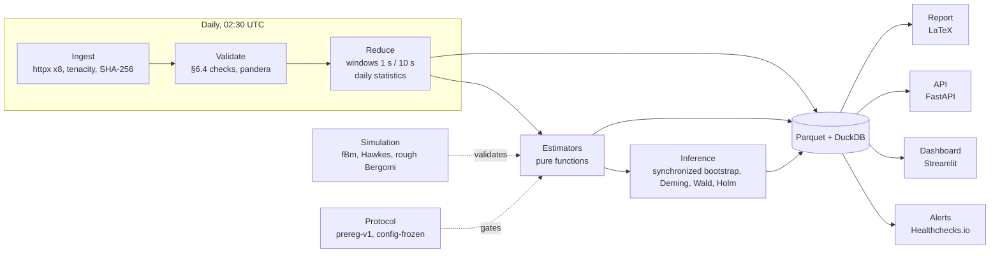

# Architecture



After the reduction, no stage reads raw trades again: the zip of a (pair, day) is
deleted as soon as its windows and event-time statistics are written.

## Stages and modules

| Stage | Module | Input → output | Acceptance (tested) |
|---|---|---|---|
| M1 Ingest | `ofs.ingest` | universe, dates → `raw/`, `manifest` | re-running a downloaded range downloads nothing; a 404 before listing is "not listed" |
| M2 Validate | `ofs.validate` | raw day → `validation_report` | each check has a deliberately corrupted file |
| M3 Reduce | `ofs.reduce` | raw day → `bins_1s`, `bins_10s`, `daily_stats/*` | every statistic equals a naive computation to 1e-9 |
| M4 Simulate | `ofs.simulate` | parameters → paths | fBm autocovariance within 2 %; Hawkes branching ratio within 0.01 |
| M5 Estimators | `ofs.estimators` | daily statistics → `estimates` | bias < 0.02 and 95 % coverage in [93 %, 97 %] on the grid (documented where it fails) |
| M6 Inference | `ofs.inference` | estimates + replicates → `tests` | size at 1 % in [0.5 %, 2 %] on synthetic universes |
| F Forecast | `ofs.forecast` | 5-year daily history + development estimates → `forecast/` | no forecast reads a day after its origin; exact predictor = conditional expectation in simulation; wins under simulated rough volatility |
| L2 Collect | `ofs.collect` | WebSocket depth + trades → `l2/` | Binance's sequence rules tested on scripted gaps; live check without resync |
| M7 Report | `ofs.report` | tables → `paper/` | `make report` |
| M8 API | `ofs.api` | tables → JSON | read-only, rate-limited |
| M9 Dashboard | `dashboards/app.py` | tables → web | five pages (forecasting added) |
| M10 CLI | `ofs.cli` | — | non-zero exit code on failure |

## Principles

* **Idempotence**: every output is named by (pair, day, version); re-running changes
  nothing, changing the version recomputes ([ADR 0002](adr/0002-versioned-daily-outputs.md)).
* **Data contracts**: every table has a pandera schema checked on write (`ofs.schemas`).
* **Research / production separation**: notebooks explore, the package computes; no
  number of the report comes from a notebook.
* **Configuration outside the code**: windows, grids, universe live in `config/`.

## Store layout

```
data/
  raw/{market}/{kind}/{pair}/...zip            temporary
  manifest/manifest.parquet                    one row per (pair, market, kind, day)
  validation/symbol=/market=/month=/day.parquet
  cache/validation.parquet                     all reports; only new day files are read again
  bins_10s|bins_1s/symbol=/market=/month=/{day}__v{version}.parquet
  daily_stats/{kind}/symbol=/market=/month=/{day}__v{version}.parquet
  daily_stats/{kind}/symbol=/market=/month=/{YYYY-MM}__pack.parquet   closed months (ADR 0016)
  estimates/estimates_{sample}.parquet         + bootstrap replicates and day indices
  tests/tests_{sample}.parquet                 + residuals, controls, robustness
  forecast/forecasts_{sample}.parquet          + evaluation_{sample}, tests_{sample} (F1-F3)
  l2/um/{symbol}/{day}/{HH}_{book|trades}.parquet   L2 collector (optional)
  monitoring/changepoints.parquet              change-point monitor of H0
  simulation/summary_{profile}.parquet         + study_{profile}, cells_{profile}_{hash}/ (checkpoints),
                                               forecast_study (forecast models on simulated data)
  quality/day_states.parquet                   O1: the state of every pair-day (ofs quality)
  logs/events-YYYY-MM-DD.jsonl                 one JSON event per (stage, pair, day)
  status/pipeline_status.json
```

The API and the dashboard load these tables with polars and query them through an
in-memory DuckDB connection with bound parameters (paths are never put in SQL).
