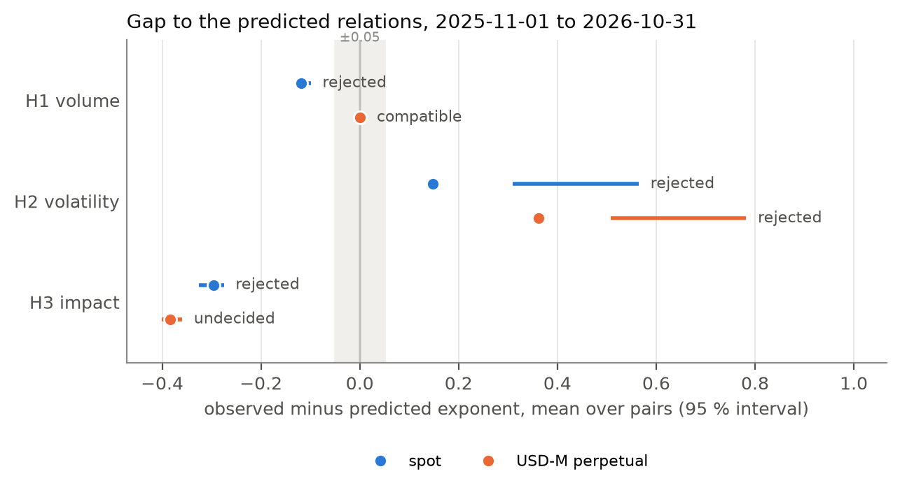

# orderflow-scaling

This project checks, pair by pair on about sixty cryptocurrencies, whether a single
parameter — the persistence `H0` of the signed order flow — fixes the roughness of volume,
the exponent of market impact and the roughness of volatility, as predicted by
Muhle-Karbe, Ouazzani Chahdi, Rosenbaum & Szymanski (2026).

| Prediction | Exponent | `H0 = 3/4` |
|---|---|---|
| Signed flow | `H0` | 0.75 |
| Volume rate | `H0 − 1/2` | 0.25 |
| Extraday volatility | `2H0 − 3/2` | 0 |
| Impact (constant-rate meta-order, in time) | `2 − 2H0` | 0.5 |

<!-- results:start -->

**Result on the confirmation year** (2025-11-01 to 2026-10-31; 60 spot pairs, 59 perpetuals; configuration frozen before that year was used). The gap is the observed exponent minus the prediction, averaged over pairs, with its 95 % interval. A relation is *compatible* when the joint test does not reject and the interval lies within ±0.05, *rejected* when the test rejects and the gap exceeds 0.05, *undecided* otherwise.

| Prediction | Spot | Perpetual |
|---|---|---|
| H1, volume roughness: `H_vol = H0 − 1/2` | rejected, gap −0.119 [−0.128, −0.099] | compatible, gap +0.001 [−0.012, +0.011] |
| H2, volatility roughness: `H_σ = 2H0 − 3/2` | rejected, gap +0.148 [+0.310, +0.565] | rejected, gap +0.362 [+0.508, +0.782] |
| H3, impact exponent, exploratory: `δ = 2 − 2H0` | rejected, gap −0.296 [−0.326, −0.275] † | undecided, gap −0.384 [−0.401, −0.359] † |

Where an interval does not contain its gap, most estimates of that exponent sit on the lower bound of their range, so their bootstrap is lopsided; the paper's reading aids count these cases.

† The control estimators find a gap that differs by more than 0.05: by the pre-registered rule this result does not count on its own.

Forecasting the average of the next 22 days (mean QLIKE ratio, below 1: the model forecasts better): F1, the rough predictor against HAR for volatility: 0.730 (undecided) on spot, 0.730 (undecided) on perpetuals; F2, the order-flow H against the measured H for volatility: 1.014 (undecided) on spot, 0.996 (equivalent) on perpetuals; F3, the rough predictor against HAR for volume: 0.889 (undecided) on spot, 0.880 (undecided) on perpetuals.

<!-- results:end -->

* [Architecture](architecture.md): six stages, one store, four outputs.
* [Data](data.md): Binance Vision formats and quality controls.
* [Estimators](estimators.md): what is estimated, how, and what simulation says about it.
* [Protocol](protocol.md): pre-registration, development and confirmation samples.
* [Operations](operations.md): daily run, monitoring, incident procedures.
* [Compliance](compliance.md): every requirement of the specification, with its evidence.
* [Design decisions in ten questions](design-faq.md): the choices a reviewer will question, answered.

Beyond the core tests:

* [Forecasting](forecasting.md): does roughness forecast daily volatility and volume? An
  exact rough-volatility predictor against HAR, out of sample, with live daily forecasts.
* [Change-point monitor](changepoints.md): CUSUM and Shiryaev–Roberts alarms when a pair's
  `H0` leaves its development range.
* [L2 collector](l2-collector.md): local order books of the perpetuals from the WebSocket
  stream, sampled every second with every trade.

"Production grade" here means: one command rebuilds every result from scratch, the
pipeline updates itself every day, every module has its tests, everything runs in a
container and reports its own failures.
