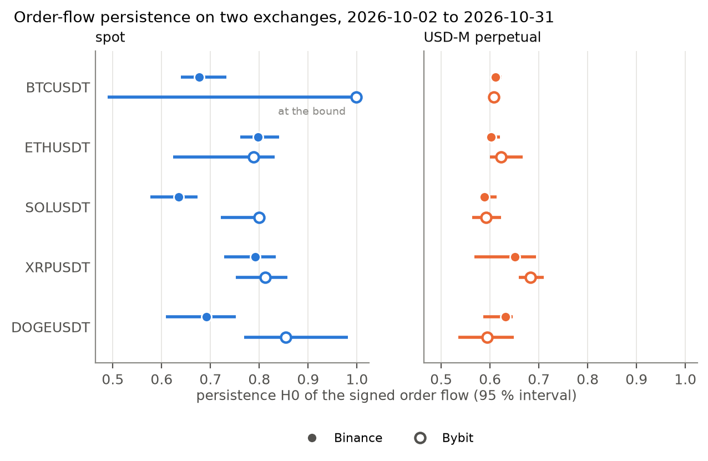

# A second venue: Bybit (exploratory)

Every confirmatory result of this project comes from one exchange. Crypto order flow is
split across venues, and the persistence `H0` measured on Binance need not be that of the
market: the paper lists this among its limitations. This page measures how much the
answer depends on the venue, on a small scale and outside the frozen protocol.

## What is compared

For the five most liquid pairs, spot and linear perpetual, over the same days:

* **Binance**: the daily statistics of the main pipeline.
* **Bybit**: the daily trade files of its public archive
  ([data sources](data-sources.md)), reduced by the same code into a separate folder
  (`data/venues/bybit`), so the two venues never mix.

The exponent is the principal `H0` estimator of the study (mixed fractional model on the
flow centred day by day in proportion to volume), fitted on the days available on each
venue. The interval is a moving-block bootstrap over days.

Three differences from the confirmatory tests, to keep in mind when reading:

1. **Descriptive.** No hypothesis was registered for this comparison and no decision rule
   applies; the protocol guard treats it like the rolling estimates.
2. **Intervals not calibrated.** The confirmatory intervals are widened by a factor fixed
   in the simulation study; these are raw, on one month, so they are narrow.
3. **No checksums.** Bybit publishes none: a file counts when its gzip stream decompresses
   to the end and the reduction's own controls pass. Bybit lists every fill, Binance one
   row per taker order and price; fills with the same time, side and price are merged.

## Result

<!-- results:start -->

Days 2026-10-02 to 2026-10-31, restricted for each pair to the days present on both venues. Principal `H0` estimator; 95 % moving-block bootstrap interval over days, without the calibration of the confirmatory intervals. Difference: Binance minus Bybit.

| Pair | Market | Binance | Bybit | Difference | Days | Trades a day, thousands (Binance / Bybit) |
|---|---|---|---|---|---|---|
| BTCUSDT | spot | 0.677 [0.639, 0.732] | 0.999 [0.490, 0.999] † | −0.322 | 30 | 832 / 247 |
| BTCUSDT | perpetual | 0.612 [0.602, 0.624] | 0.608 [0.597, 0.620] | +0.004 | 29 | 1,050 / 839 |
| ETHUSDT | spot | 0.797 [0.761, 0.840] | 0.788 [0.624, 0.832] | +0.010 | 30 | 609 / 145 |
| ETHUSDT | perpetual | 0.603 [0.592, 0.620] | 0.622 [0.599, 0.667] | −0.020 | 29 | 1,000 / 797 |
| SOLUSDT | spot | 0.635 [0.577, 0.674] | 0.800 [0.721, 0.806] | −0.164 | 30 | 161 / 54 |
| SOLUSDT | perpetual | 0.588 [0.580, 0.614] | 0.592 [0.563, 0.623] | −0.004 | 29 | 253 / 126 |
| XRPUSDT | spot | 0.792 [0.728, 0.834] | 0.812 [0.752, 0.858] | −0.021 | 30 | 153 / 42 |
| XRPUSDT | perpetual | 0.651 [0.568, 0.694] | 0.683 [0.658, 0.711] | −0.031 | 29 | 212 / 135 |
| DOGEUSDT | spot | 0.691 [0.609, 0.752] | 0.854 [0.769, 0.982] | −0.163 | 30 | 100 / 18 |
| DOGEUSDT | perpetual | 0.632 [0.586, 0.646] | 0.594 [0.535, 0.648] | +0.037 | 29 | 145 / 67 |
| Mean of 4 pairs | spot | | | −0.084 | | |
| Mean of 5 pairs | perpetual | | | −0.003 | | |

† Estimate on a bound of the search range (0.001 to 0.999): not identified on these days, and left out of the mean difference.



<!-- results:end -->

## Reading

Written for the run of 2026-11-15 (October 2026, five pairs).

* **Perpetuals: the venue does not matter.** On each of the five pairs the intervals
  of the two venues overlap, no difference exceeds 0.04 and their mean is a few
  thousandths. The persistence near 0.6 measured on Binance's perpetuals is not a
  feature of Binance.
* **Spot: no conclusion.** Bybit's spot market has three to six times fewer trades on
  these pairs. Two pairs agree, two are higher on Bybit, and one sits on a bound of
  the search range: it is not identified on one month. Either order flow is more
  persistent on the thinner venue, or the estimator needs more trades than a month
  of it offers; this comparison cannot tell which.
* A month and five pairs describe; they do not test. A longer window on spot is the
  next step.

## Run it

```bash
uv run ofs venue-bybit --to 2026-10-31 --days 30 --publish
```

About 300 files (2 to 15 MB each) are downloaded, reduced and deleted; the daily
statistics stay under `data/venues/bybit`, so a second run only recomputes the table.
`--symbol` selects other pairs, `--market spot` or `--market um` one market.
