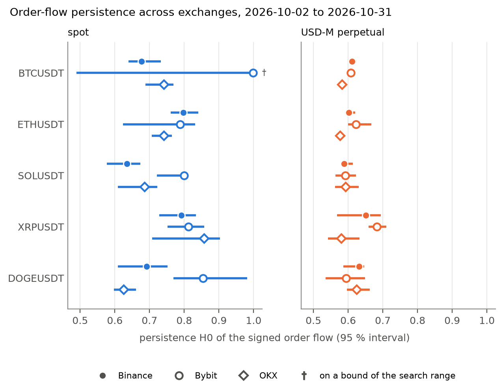

# Other venues: Bybit and OKX (exploratory)

Every confirmatory result of this project comes from one exchange. Crypto order flow is
split across venues, and the persistence `H0` measured on Binance need not be that of the
market: the paper lists this among its limitations. This page measures how much the
answer depends on the venue, on a small scale and outside the frozen protocol.

## What is compared

For the five most liquid pairs, spot and linear perpetual, over the same days:

* **Binance**: the daily statistics of the main pipeline.
* **Bybit** and **OKX**: the daily trade files of their public archives
  ([data sources](data-sources.md)), reduced by the same code into folders of their own
  (`data/venues/bybit`, `data/venues/okx`), so the venues never mix.

The exponent is the principal `H0` estimator of the study (mixed fractional model on the
flow centred day by day in proportion to volume), fitted on the days present on every
venue. The interval is a moving-block bootstrap over days, with the same resamples on
each venue.

Four differences from the confirmatory tests, to keep in mind when reading:

1. **Descriptive.** No hypothesis was registered for this comparison and no decision rule
   applies; the protocol guard treats it like the rolling estimates.
2. **Intervals not calibrated.** The confirmatory intervals are widened by a factor fixed
   in the simulation study; these are raw, on one month, so they are narrow.
3. **Weaker integrity checks.** Neither archive publishes checksums. A Bybit file counts
   when its size is the announced one and its gzip stream decompresses to the end; an OKX
   file when the CRC of its zip member is right. The reduction's own controls then apply.
4. **Different conventions, aligned here.** Both archives list every fill, Binance one row
   per taker order and price: fills with the same time, side and price are merged. OKX
   cuts its daily files at midnight in Hong Kong (16:00 UTC), so each UTC day is rebuilt
   from two files; its perpetual sizes are in contracts, a constant factor on which no
   scaling exponent depends.

## Result

<!-- results:start -->

Days 2026-10-02 to 2026-10-31, restricted for each pair to the days present on every venue. Principal `H0` estimator; 95 % moving-block bootstrap interval over days, without the calibration of the confirmatory intervals.

| Pair | Market | Binance | Bybit | OKX | Binance − Bybit | Binance − OKX | Days | Trades a day, thousands (Binance / Bybit / OKX) |
|---|---|---|---|---|---|---|---|---|
| BTCUSDT | spot | 0.677 [0.639, 0.732] | 0.999 [0.490, 0.999] † | 0.741 [0.688, 0.769] | −0.322 | −0.065 | 30 | 832 / 247 / 208 |
| BTCUSDT | perpetual | 0.612 [0.602, 0.624] | 0.608 [0.597, 0.620] | 0.582 [0.578, 0.586] | +0.004 | +0.029 | 29 | 1,050 / 839 / 1,006 |
| ETHUSDT | spot | 0.797 [0.761, 0.840] | 0.788 [0.624, 0.832] | 0.742 [0.707, 0.764] | +0.010 | +0.055 | 30 | 609 / 145 / 168 |
| ETHUSDT | perpetual | 0.603 [0.592, 0.620] | 0.622 [0.599, 0.667] | 0.577 [0.572, 0.587] | −0.020 | +0.026 | 29 | 1,000 / 797 / 1,218 |
| SOLUSDT | spot | 0.635 [0.577, 0.674] | 0.800 [0.721, 0.806] | 0.686 [0.608, 0.723] | −0.164 | −0.051 | 30 | 161 / 54 / 67 |
| SOLUSDT | perpetual | 0.588 [0.580, 0.614] | 0.592 [0.563, 0.623] | 0.593 [0.562, 0.630] | −0.004 | −0.005 | 29 | 253 / 126 / 211 |
| XRPUSDT | spot | 0.792 [0.728, 0.834] | 0.812 [0.752, 0.858] | 0.858 [0.707, 0.903] | −0.021 | −0.066 | 30 | 153 / 42 / 44 |
| XRPUSDT | perpetual | 0.651 [0.568, 0.694] | 0.683 [0.658, 0.711] | 0.581 [0.542, 0.633] | −0.031 | +0.071 | 29 | 212 / 135 / 151 |
| DOGEUSDT | spot | 0.691 [0.609, 0.752] | 0.854 [0.769, 0.982] | 0.626 [0.598, 0.661] | −0.163 | +0.065 | 30 | 100 / 18 / 35 |
| DOGEUSDT | perpetual | 0.632 [0.586, 0.646] | 0.594 [0.535, 0.648] | 0.625 [0.596, 0.662] | +0.037 | +0.007 | 29 | 145 / 67 / 118 |
| Mean difference | spot | | | | −0.084 (4 pairs) | −0.012 (5 pairs) | | |
| Mean difference | perpetual | | | | −0.003 (5 pairs) | +0.026 (5 pairs) | | |

† Estimate on a bound of the search range (0.001 to 0.999): not identified on these days, and left out of the mean difference.



<!-- results:end -->

## Reading

Written for the run of 2026-11-16 (October 2026, five pairs).

* **Perpetuals: the venue matters little.** The three exchanges give a persistence
  between 0.57 and 0.69 for every pair. Bybit differs from Binance by a few thousandths
  on average and by less than 0.04 on any pair; OKX is lower than Binance by about 0.03
  on average and 0.07 at most. The persistence near 0.6 measured on Binance's
  perpetuals is not a feature of Binance.
* **Spot: noisier, without a direction.** Bybit and OKX trade between two and six
  times less than Binance on these pairs. OKX differs from Binance by 0.07 at most,
  above on some pairs and below on others; Bybit is higher on two pairs, by 0.16, and
  not identified on a third. On a thin market one month is short.
* On perpetuals the differences between venues, a few hundredths, are small next to
  the gap between spot and perpetuals on Binance (about 0.1), which the confirmatory
  tests measure (H5).
* A month and five pairs describe; they do not test.

## Run it

```bash
uv run ofs venues --to 2026-10-31 --days 30 --publish
```

About 600 files (1 to 15 MB each) are downloaded, reduced and deleted; the daily
statistics stay under `data/venues/`, so a second run only recomputes the table.
`--venue bybit` or `--venue okx` selects one archive, `--symbol` other pairs,
`--market spot` or `--market um` one market.
